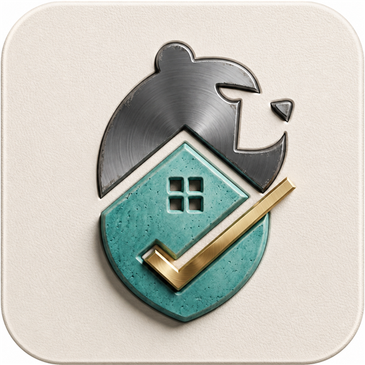
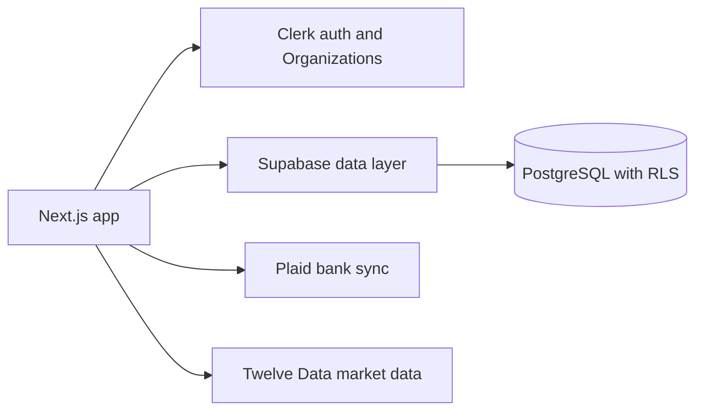

<div align="center">
  

  # BaerVault

  **A calm, shared home for your household finances.**

  [](https://nextjs.org/) [](https://react.dev/) [](https://www.typescriptlang.org/) [](https://supabase.com/) [](https://vercel.com/)
</div>

## Screenshots

<!-- Add real BaerVault screenshots at these paths. -->

| Home | Budget | Transactions |
| --- | --- | --- |
|  |  |  |

**Live demo:** [Open BaerVault](https://YOUR_DEMO_URL)

## Features

- **Home:** monthly budget status, recent activity, upcoming payments, goals, and net worth.
- **Transactions:** household ledger, bank transaction review, and recurring payments.
- **Budget:** category plans, purchase entry, and cash flow.
- **Accounts:** connected accounts, investments, and savings goals.
- **Household:** member access, invitations, and spending by member.

## How it fits together



The public demo uses synthetic data. Authenticated household records are scoped through Clerk Organizations and Supabase row-level security.

## Tech stack

| Area | Tools |
| --- | --- |
| App | Next.js 16, React 19, TypeScript |
| UI | Mantine, CSS Modules, Tabler Icons, Recharts |
| Identity | Clerk and Organizations |
| Data | Supabase PostgreSQL, row-level security |
| Finance integrations | Plaid, Twelve Data |
| Tests | Node test runner, PGlite |

## Quick start

```bash
git clone https://github.com/sampbaer-creator/BaerVault.git
cd BaerVault
npm install
cp .env.example .env.local
npm run dev
```

Open `http://localhost:3000`. Configure the required service credentials in `.env.local`; the public demo is available at `/demo` without sign-in. See [docs/DEVELOPMENT.md](docs/DEVELOPMENT.md) for environment setup, migrations, and test commands.

## License

License: **Pending owner selection.** No license file is currently present.
